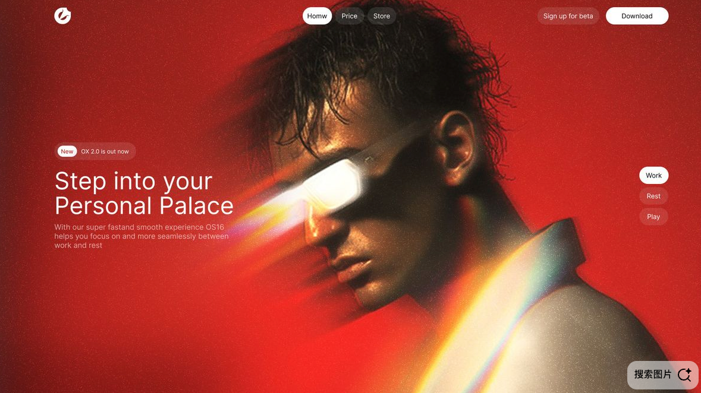
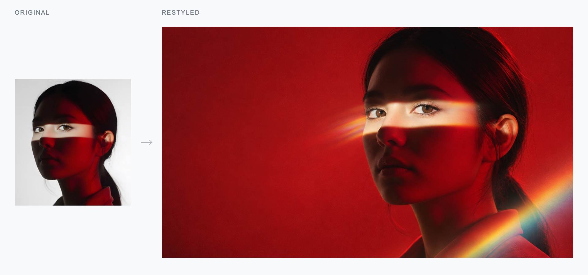
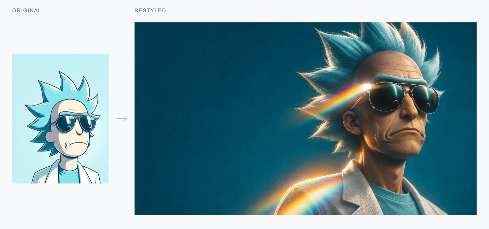
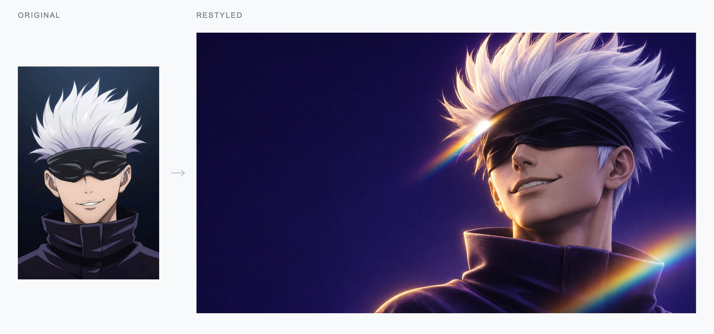
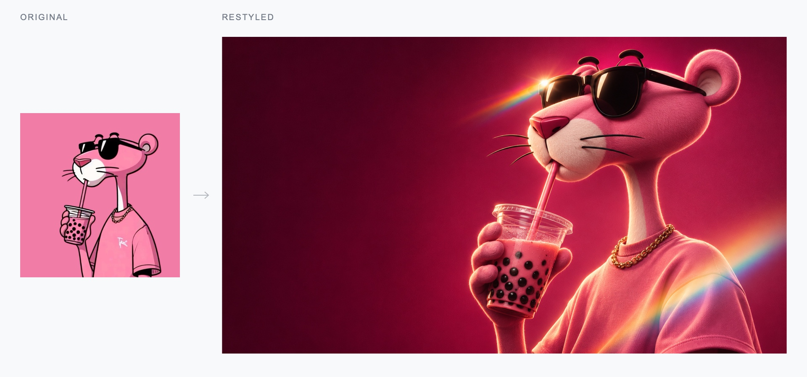

# CatchArt Image Style

**Extract one image’s style. Redesign a whole set around it.**

[English](#how-it-works) · [简体中文](#中文) · **v1.2.0**

`catchart-image-style` turns a visual reference into a portable `style.md`, then helps your agent use that direction to redesign other images. Keep each subject’s defining features while bringing the whole set into one visual language.

## Style reference

The original reference used for all four examples below:



## Before → after

Each comparison combines the actual input and generated result. Colors change with the subject; the lighting, grain, optical highlights and homepage composition stay connected.









## How it works

**Observe → Extract → Adapt → Generate → Check**

- Extracts palette, lighting, composition, material, typography and the few features that define the style.
- Separates what to keep from what can change: subject, colors, framing and purpose.
- Delivers a short summary and `style.md`; batch tasks add individual images, final instructions and processing status in the same folder.

The skill uses your agent’s vision and image-generation tools. No CatchArt account or backend is needed. Without image generation, it delivers the style file and per-image instructions, clearly marked as not rendered. Results depend on the host model and rendering service.

## Use it

```bash
git clone https://github.com/damonjobs2-dev/catchart-image-style.git ~/.codex/skills/catchart-image-style
```

If the directory already exists, update or back it up first. Other agents can read [SKILL.md](SKILL.md) using their own skill-installation convention.

Attach your images and ask:

```text
Use $catchart-image-style. Image 1 is the style reference.
Redesign the remaining images as a consistent set of website heroes.
Keep each subject’s defining features. Colors may adapt to the subject.
Leave space for copy and do not render text.
```

For extraction only, ask for a short summary and `style.md`. You can reuse that file in another conversation; see the [example](examples/style.md).

Optional local palette helper and tests:

```bash
python3 -m pip install -r requirements.txt
python3 scripts/palette.py reference.png --colors 8
python3 -B -m unittest discover -s tests -v
```

## 中文

**提取一张图的风格，再把一组图片重新设计成同一套视觉。**

`catchart-image-style` 会拆解参考图的配色、光影、构图、材质与关键特征，整理成可复用的 `style.md`，再将这套规则应用到其他图片。保留各自人物与辨识点，颜色可以调整，整体视觉保持一致。

上方保留一张原始风格参考；四张案例各自合并了原图与实际生成图，展示照片、插画人物和非人形角色的重新设计效果。

附图后直接说明需求：

```text
使用 $catchart-image-style。第一张是风格参考，其他是待处理图片。
统一做成横版网页首页宣传图，保留各自人物和关键配件。
颜色可根据人物调整，左侧留出文案空间，图内不生成文字。
```

只分析时，交付简短概括、参考图与 `style.md`；批量设计时，再交付逐张结果、最终指令和处理状态。文件集中在“核心关键词_style_年月日时分秒”目录中，可交给其他支持文件读取的对话继续创作。

无需 CatchArt 账号，实际生成由当前 Agent 的生图工具完成。完整流程见 [SKILL.md](SKILL.md)。

## License

Skill code and instructions are MIT licensed. Third-party reference artwork and characters retain their original rights.
