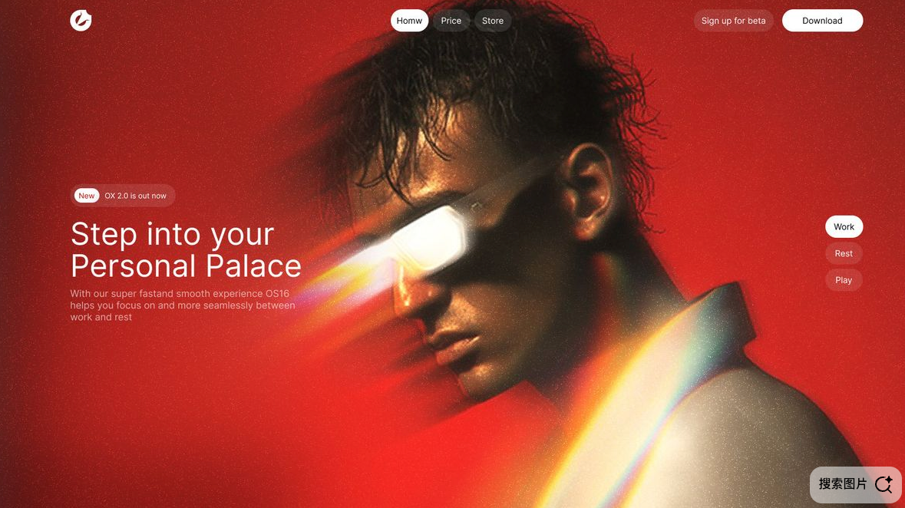

# 棱镜人像科技广告 · 风格档案

## 风格概括

复古未来主义的时尚科技广告风格：以高饱和红色满版背景、暗调写实人像与过曝棱镜光带建立冲击力，再用细腻颗粒和克制的白色界面文字形成兼具模拟影像质感与数字产品感的视觉语言。

### 五个风格锚点

1. **红色占据主要画面**：砖红、猩红与暗红连续过渡，形成包围人物的色场。
2. **暗调人像承载真实细节**：凌乱发丝、皮肤高光、耳部与颈部阴影保留立体感。
3. **强亮光带贯穿主体**：眼部目镜和肩颈附近出现白热中心、暖黄及青绿边缘的彩色光晕。
4. **细颗粒覆盖图像**：红色背景和人物表面均有可见颗粒，形成模拟胶片与广告印刷的联想。
5. **图像强烈，界面克制**：左侧简短文案，顶部与右侧少量胶囊控件，以白色和半透明红色组织层级。

## 参考图与分析范围

输入为 1179 × 662 像素截图，横向比例约 1.78:1，接近 16:9。画面包含一个产品网站首屏的静态呈现，本档案分析其图像与可见版式，不包含网站实际测量或交互验证。

右下角“搜索图片”浮层属于截图叠加界面，不计入作品风格。原始网站地址、作者、品牌含义、制作软件及实际摄影参数未知。

以下“观察”指截图中直接可见的特征；“取样”指本地读取截图得到的颜色；“推断”指对视觉效果的解释，不代表真实生产流程。

## 媒介、人物与造型

**观察**：主体具有摄影级写实观感，画面主要呈现人物头部、颈部和肩部。人物低头、向画面左侧转脸，眼部有白色高亮目镜；发丝较湿润、凌乱，深色头发与红背景形成清晰轮廓。

皮肤和衣领没有被简化成平面色块，保留了鼻梁、颧骨、耳部和颈部的立体明暗。部分细节被深阴影和强亮光覆盖，注意力集中在脸部与目镜。

**推断**：整体接近经过强烈调色与光效合成的时尚广告人像。仅凭截图无法判定素材来自摄影、三维渲染还是生成图；复用时保留写实质感即可，无需限定制作工具。

## 配色

整体以红色为主，深棕黑提供暗部，白色及暖黄提供亮部，少量青绿色边缘构成冷暖分离。下面前三个色号来自整图聚类代表值；暖黄取自局部像素，白色取自顶部按钮。它们是截图参考色，不是源站品牌 Token，也没有对应的作品面积统计。

| 视觉角色 | 参考色号 | 位置与应用 |
| --- | --- | --- |
| 主导亮红 | #D62B24 | 大面积红色背景的较亮区域，形成视觉基调 |
| 辅助暗红 | #9F221D | 背景较暗部分与暖色阴影，拉开红色内部层次 |
| 深棕黑 | #331C17 | 人物头发及暗部的聚类近似色，稳定明暗重心 |
| 暖黄强调 | #FCCF58 | 肩颈附近棱镜光带的局部像素样本 |
| 白色强调 | #FFFFFF | 顶部主要按钮、文字及光带的高亮观感 |

光带中还可观察到橙红、青绿和少量偏紫的过渡。这些颜色依附光效出现，适合维持小面积；不必扩展成多色背景或整套彩虹界面。

## 光影、明度与光学效果

**观察**：头发、面部背光侧与颈部形成深暗块面；额头、鼻梁、颧骨和耳缘保留暖色反射与高光。脸部的明暗转折较有力度，亮部和背景红色相互呼应。

眼部目镜具有接近纯白的亮核，光迹朝左下方向拉伸，带有暖黄、橙红及局部彩色边缘。肩颈附近另有一条从下方斜向右上延伸的宽光带，中央明亮，外缘柔和并出现冷暖色散。两处斜向光效与人物倾斜的头部形成共同动势。

**推断**：这些光效让人联想到棱镜色散、镜头眩光、光晕溢出与运动拖影的叠加；它们也可能是后期图层。复用的关键是“白热中心—彩色边缘—柔和衰减”的层次，真实光源位置和灯具数量无法确定。

## 镜头感与空间

**观察**：近景肖像，脸部呈三分之四侧面，肩部被画幅裁切。背景没有明确环境细节，人物靠轮廓、遮挡与明暗建立前后关系。

画面没有足够的可辨识背景供测量景深；近景感主要由人物占幅和裁切产生。具体镜头焦距、光圈、快门、相机与真实拍摄机位未知，不作为复用参数。

## 构图与视觉动线

### 主体与留白

人物从画面中部延展至右侧和底部，头发触及上边缘，肩部在右下形成较大体块。左侧中部留作文案区域，红色背景既作为环境色，也作为可阅读的负空间。

第一视觉焦点是目镜的白色亮核；第二焦点是脸部和肩颈光带；白色标题形成独立阅读入口。可以从标题进入人物，也可以从高亮目镜回到标题，两者通过横向关系相互连接。

### 版式关系

- 左上是小尺寸白色标志，顶部中间为三项胶囊导航，右上为次级入口和白色主按钮。
- 左侧内容由小型更新标签、两行主标题与短说明组成，整体左对齐。
- 右侧中部竖排三个短标签，当前项以白底深字突出，其余项融入半透明红底。
- 控件外围留白充足，视觉重量低于人像；没有用多个大卡片切碎满版图像。

以上是静态截图中的关系观察，不是 DOM、栅格或像素坐标测量。画面没有展示悬停、点击、加载或滚动效果，无法确认其动效和响应式规则。

## 质感与工艺

**观察**：背景和人物表面可见连续细颗粒，皮肤带有柔亮反射，发丝有细碎锐利边缘。强亮目镜和光带周围发生柔化与颜色外溢，使局部清晰细节和柔亮区域形成对比。

**推断**：这些特征带来复古胶片、模拟光学与时尚广告印刷的联想。实际胶片型号、滤镜及颗粒生成方式无法确认；颗粒的强度也可能受到截图压缩影响，不宜机械放大。

## 字体与界面视觉

**观察**：英文主标题是较轻或常规字重的无衬线体，字形简洁、开放，没有夸张装饰。大标题与小号说明文字建立明显层级，文案量较少，白色文字从红背景中直接浮现。

辅助文字降低亮度，保持可读但不争抢人物。按钮和标签采用胶囊轮廓，白底主要动作与半透明次要动作形成可见区别。

具体字体名称、字号、字距、透明度及圆角数值无法从截图确认。复用时以视觉关系为依据，不将估计值写成原站规范。

## 二次创作规则

1. **保留强背景与暗主体的关系**：使用一种高饱和暖色铺满画面，主体保留深暗体块及局部皮肤或材质细节，避免所有区域同时明亮。
2. **保留有限的光学焦点**：设置一处主要白热亮核和一处辅助斜向光带，以柔和色散边缘扩散；人物轮廓与关键面部仍需可辨认。
3. **保留写实与模拟质感**：主体有真实的材质和立体明暗，颗粒细而均匀，局部高光柔化。用这些可见结果约束风格，不限定未知设备和软件。
4. **保留图像主导的排版**：人物占据主要视觉空间，在相对干净的一侧放短标题和说明；界面采用白色无衬线文字及少量胶囊控件，避免大面积卡片遮住图像。
5. **保留动线并适配新画幅**：让人物朝向、目镜光迹和肩部光带形成连贯方向。原作约 16:9，改为竖幅或方形时重排文案与裁切，保留焦点和阅读区域。

### 应保留与可调整

**风格保留项**：强烈单色背景、深暗写实主体、克制的暖冷色散、局部白热高光、细颗粒、少字的白色界面。

**可替换内容**：人物、目镜产品、品牌标志、标题文案、导航数量与具体主题。没有界面需求时可只沿用人像广告的光色与构图；需要产品网页时再采用其图文层级。

红色是这张参考图最强的识别线索。换成蓝、紫或其他色系属于主动风格变体，需要重新平衡主体肤色、光带冷暖和文字对比。

## 如何用于新的创作

将本文件与assets/style-reference.png 提供给支持读取文档和图片的创作对话，再说明新的主体、产品、用途、比例及希望保留的风格特征。接收方可据此创作画面、编写提示词或提出界面方案，具体任务以当次需求为准。

仅提供本文时，风格规则仍可独立阅读；同时提供参考图更便于核对光效与颗粒。生成结果取决于接收模型能力。本文件是视觉参考资料，无需安装为 Skill。
